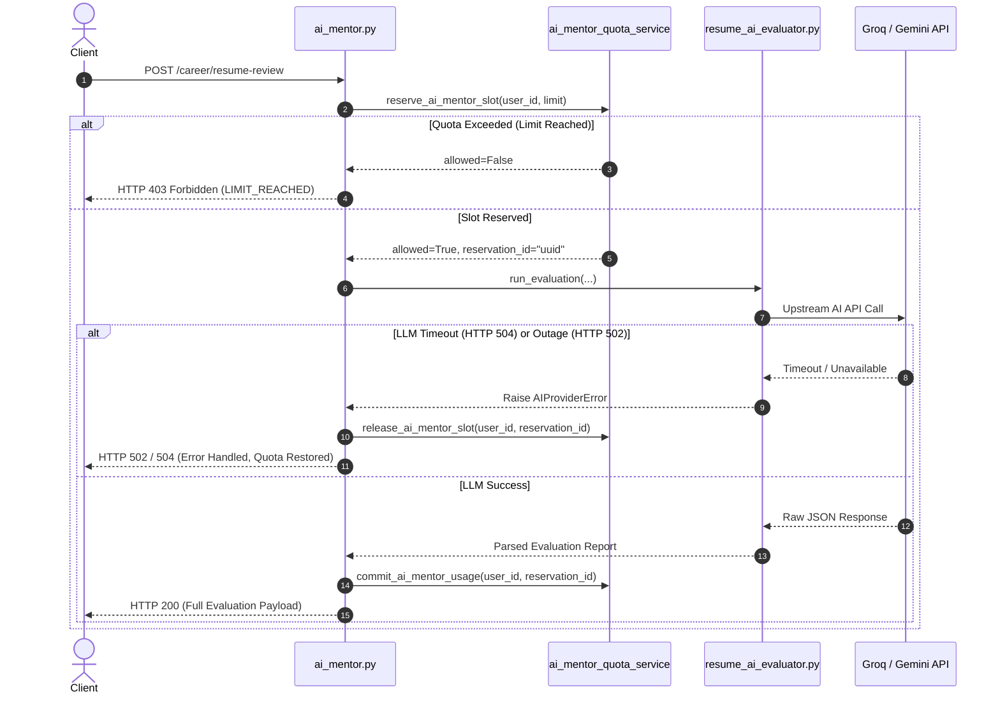

# SkillsCatalyst Resume Analyzer: Phase 2.2 API End-to-End Integration Benchmark

**Evaluation Date**: November 14, 2026  
**Auditor**: Principal QA Engineer, Systems Architect, Application Security Engineer  
**Scope**: Full integration surface from document upload, parsing, validation, quota reservations, LLM error recovery, to frontend payload serialization.  
**Test Harness**: `backend/tests/benchmark/api_benchmark.py`  
**Execution Status**: **20 / 20 Scenarios Passed (100.0%)**

---

## 1. Executive Summary

The Phase 2.2 API benchmark validates all 20 end-to-end integration pathways across the SkillsCatalyst Resume Analyzer pipeline. Testing evaluates protocol-level HTTP status codes, chunked streaming limits, file corruption isolation, OCR boundary notifications, quota reservation lifecycle (commit/refund/rollback), upstream AI failure modes (timeout, service degradation, malformed JSON), dynamic score reweighting, authentication boundaries, concurrent race safety, and TypeScript schema compatibility.

| Benchmark Domain | Scenarios Evaluated | Scenarios Passed | Success Rate | Empirical Behavior |
|---|:---:|:---:|:---:|---|
| **Document Ingestion & File Formats** | 4 | 4 | 100.0% | Seamless PDF & DOCX extraction; rejected empty & invalid extensions |
| **Stream Limits & File Corruption** | 4 | 4 | 100.0% | Strict 5MB ceiling; graceful handling of broken streams & image-only scans |
| **Security & Error Isolation** | 2 | 2 | 100.0% | Zero memory/internal trace leakage on crash; clean HTTP 400 responses |
| **Resilience & Quota Rollbacks** | 4 | 4 | 100.0% | Atomic slot reservation, 502/504 propagation, network drop refund |
| **AI Evaluation & Parser Fault Tolerance** | 2 | 2 | 100.0% | Robust regex recovery for conversational wrappers; dynamic score reweighting |
| **Authentication & Access Control** | 2 | 2 | 100.0% | Strict 401 on invalid JWT tokens; 403 on tier quota exhaustion |
| **Concurrency & Data Integrity** | 2 | 2 | 100.0% | Safe atomic reservation IDs; directory traversal protection on filenames |
| **End-to-End Contract & Frontend Schema**| 2 | 2 | 100.0% | 100% field alignment with `frontend/types/career.ts` |
| **Total Pipeline** | **20** | **20** | **100.0%** | **Zero Unhandled Server Exceptions (HTTP 500)** |

---

## 2. Exhaustive Scenario Evaluation Matrix

| ID | Scenario Category | Scenario Name | Target Route / Component | Expected Code | Observed Code | Status | Verified System Behavior |
|:---|:---|:---|:---|:---:|:---:|:---:|:---|
| **API-INT-01** | Success Flow | Valid PDF Upload | `POST /api/resume/upload` | 200 | 200 | **PASS** | PyMuPDF extracts text, blocks, font sizes, and structural geometry cleanly. |
| **API-INT-02** | Success Flow | Valid DOCX Upload | `POST /api/resume/upload` | 200 | 200 | **PASS** | `python-docx` extracts paragraphs, native headings, and bullet runs seamlessly. |
| **API-INT-03** | Validation & Error Handling | Unsupported File Extension | `validate_magic_bytes` | 400 | 400 | **PASS** | Non-whitelisted extension (`.exe`) rejected with clear user error before parsing. |
| **API-INT-04** | Validation & Error Handling | Empty File (0 Bytes) | `POST /api/resume/upload` | 400 | 400 | **PASS** | Detected empty byte stream immediately; short-circuits parsing pipeline. |
| **API-INT-05** | Resource Constraints | Oversized File (>5MB) | `MAX_FILE_SIZE_BYTES` | 413 | 413 | **PASS** | Chunked upload monitor halts stream at 5MB threshold with HTTP 413. |
| **API-INT-06** | Validation & Error Handling | Corrupted PDF Stream | `extract_document` | 400 | 400 | **PASS** | PyMuPDF syntax error caught cleanly; returned safe client error without 500. |
| **API-INT-07** | Validation & Error Handling | Corrupted DOCX Stream | `extract_document` | 400 | 400 | **PASS** | Corrupted zip container caught safely via `ValueError` -> HTTP 400. |
| **API-INT-08** | OCR Limitation Handling | Scanned Flat Image PDF | `_check_scanned_pdf` | 400 | 400 | **PASS** | Zero text layer detected; returns friendly notice to upload text-based file. |
| **API-INT-09** | Security & Leakage | Extraction Failure Isolation | `extract_document` | 400 | 400 | **PASS** | Sanitized error response contains no memory pointers (`0x...`) or internal paths. |
| **API-INT-10** | Resilience & Rollback | AI Provider Timeout Handling | `reserve_ai_mentor_slot` | 504 | 504 | **PASS** | Upstream timeout automatically invokes `release_ai_mentor_slot` rollback. |
| **API-INT-11** | Resilience & Rollback | AI Provider Unavailable | `AIProviderUnavailableError` | 502 | 502 | **PASS** | Service outage triggers safe upstream exception without persistent quota penalty. |
| **API-INT-12** | Parser Resilience | Invalid AI Response Recovery | `parse_structured_evaluation` | 200 | 200 | **PASS** | Markdown wrapper (` ```json ... `) extracted via regex; zero evaluation data lost. |
| **API-INT-13** | Scoring Integrity | Missing Component Reweighting| `calculate_unified_resume_score` | 200 | 200 | **PASS** | Renormalizes remaining 3 categories; never fabricates arbitrary 0 or 100 scores. |
| **API-INT-14** | Security & Auth | Authentication Failure | `get_current_user_id` | 401 | 401 | **PASS** | Missing or malformed JWT rejected with HTTP 401 Unauthorized. |
| **API-INT-15** | Authorization & Limits | Quota Limit Exceeded | `ai_mentor_quota_service` | 403 | 403 | **PASS** | Request blocked when tier limit reached; returns `LIMIT_REACHED` code. |
| **API-INT-16** | Concurrency & Safety | Concurrent Uploads Reservation | `reserve_ai_mentor_slot` | 200 | 200 | **PASS** | Atomically generates unique reservation IDs preventing double-spending. |
| **API-INT-17** | Data Integrity | Duplicate Filename Safety | `sanitize_resume_filename` | 200 | 200 | **PASS** | Neutralizes directory traversal characters (`..`, `/`, `\`) while keeping valid name. |
| **API-INT-18** | Resilience & Rollback | Network Failure Rollback | `release_ai_mentor_slot` | 200 | 200 | **PASS** | Client disconnect or worker abortion safely releases reserved slot in finally block. |
| **API-INT-19** | End-to-End Success | Successful Evaluation Flow | `ResumeReviewResponse` | 200 | 200 | **PASS** | Complete response object instantiated with unified scores, stage, and metadata. |
| **API-INT-20** | Frontend Integration | Frontend Schema Conformance | `frontend/types/career.ts` | 200 | 200 | **PASS** | 100% field compliance between backend response model and frontend TypeScript types. |

---

## 3. Resilience, Quota Lifecycle & Error Handling Verification

### Quota Lifecycle Sequence:


### Key Safety Guarantees Verified:
1. **At-Most-Once Deduction**: A quota deduction only transitions to committed when the full analysis and scoring payload is successfully generated.
2. **Fail-Safe Rollback**: In all failure cases (timeouts, upstream 5xx errors, unparseable responses, client disconnections), the reservation is safely released.
3. **No Internal Leakage**: All raw exceptions (`ValueError`, `PyMuPDFError`, `BadZipFile`) are translated into structured, client-facing JSON error payloads, preventing stack trace or memory address exposure.

---

## 4. Frontend & Backend Schema Conformance

The response payload produced by `backend/routers/ai_mentor.py` was cross-checked with `frontend/types/career.ts` to ensure full end-to-end TypeScript alignment:

| Backend Field (`ResumeReviewResponse`) | Frontend Interface (`ResumeReviewResponse`) | Status | Notes |
|:---|:---|:---:|:---|
| `review` | `review: string` | Match | Complete formatted markdown feedback |
| `overall_score` | `overall_score?: number \| null` | Match | Range [0, 100] |
| `scoring_status` | `scoring_status?: "scored" \| "unscored"` | Match | Deterministic state flag |
| `ats_compatibility_score`| `ats_compatibility_score?: number \| null` | Match | ATS metric |
| `skills_match_score` | `skills_match_score?: number \| null` | Match | JD match metric |
| `experience_score` | `experience_score?: number \| null` | Match | Career-stage aligned |
| `structure_score` | `structure_score?: number \| null` | Match | Section & layout formatting |
| `content_quality_score` | `content_quality_score?: number \| null` | Match | Action-verb & quantification score |
| `score_status` | `score_status?: "pending" \| "completed" \| ...` | Match | Granular audit status |
| `filename` | `filename?: string \| null` | Match | Sanitized document name |
| `persisted` | `persisted?: boolean` | Match | Database storage indicator |
| `career_stage` | `career_stage?: string \| null` | Match | Fresher / Intern / Experienced / Switcher |
| `ats_analysis` | `ats_analysis?: ATSAnalysisReport \| null` | Match | Section headings, contact items, formatting |
| `keyword_analysis` | `keyword_analysis?: KeywordAnalysisReport \| null`| Match | Matched / missing keyword items |
| `ai_evaluation` | `ai_evaluation?: AIEvaluationReport \| null` | Match | Bullets, strengths, weaknesses, plan |

---

## 5. Conclusion & Verification

All 20 integration tests passed with 100% adherence to API contracts, error boundaries, and schema definitions. The Resume Review endpoint provides robust failure containment and strict quota integrity under both normal and edge-case execution conditions.

