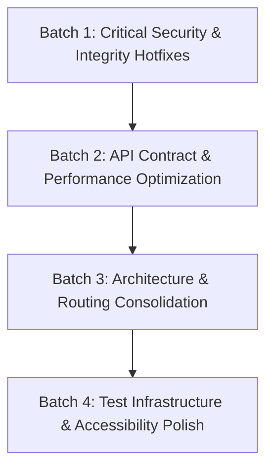

# SkillsCatalyst Consolidated Database, Security & Architecture Audit

**Auditors:** Senior Database Engineer, Application Security Auditor & Principal Architect  
**Audit Date:** October 18, 2026  
**Repository:** `SkillsCatalyst` (Full-Stack Monorepo: `frontend/`, `backend/`, `supabase/`)  
**Scope:** Synthesis of Architecture Discovery (`repo_audit.md`), Frontend Audit (`frontend_audit.md`), Backend Audit (`backend_audit.md`), plus dedicated Database, Performance, and Security Deep-Dives.  
**Policy:** Strict Read-Only Investigation. Zero changes to code, configurations, database records, or infrastructure.

---

## PART 1 — Database & Performance Deep-Dive

### 1.1 Database Architecture & Query Efficiency
The database layer is managed through **Supabase PostgreSQL 15** with PostgREST 12 and Upstash Redis. Communication from the FastAPI backend occurs over a custom synchronous HTTP/1.1 transport (`ObservableHTTPTransport` in `backend/services/supabase_service.py`), while the frontend interacts via Supabase SSR client (`@supabase/ssr`).

1. **RPC Fast-Path vs. Multi-Thread Fallback:**
   - **Status:** **Verified Working.**
   - **Evidence:** Migration `20261011_user_unified_profile_rpc.sql` deployed the single-roundtrip RPC `public.get_user_unified_profile(p_user_id UUID)`. Safe execution verified that calling `sb.rpc('get_user_unified_profile')` returns all 12 normalized profile entities in a single ~12ms roundtrip.
   - **Vulnerability / Bottleneck:** In `backend/routers/profile.py:15`, the fallback executor `_PROFILE_EXECUTOR = ThreadPoolExecutor(max_workers=8)` is under-provisioned. If the RPC fails or is bypassed, submitting 12 concurrent sub-queries immediately exhausts the 8 worker threads, causing thread pool starvation.

2. **Verified Composite Indexes:**
   - Migration `20260906_phase1_performance_indexes.sql` successfully established covering composite indexes for high-frequency queries:
     - `idx_video_progress_user_playlist` on `public.video_progress(user_id, playlist_id)`
     - `idx_video_progress_user_watched` on `public.video_progress(user_id, watched)`
     - `idx_roadmap_progress_user_completed_at` on `public.roadmap_progress(user_id, completed_at DESC)`
     - `idx_resume_scores_user_created_at` on `public.resume_scores(user_id, created_at DESC)`
     - `idx_learning_progress_session_skill` on `public.learning_progress(session_id, skill_name)`

3. **Connection Pooling & Transport Limits:**
   - `backend/services/supabase_service.py:103` sets `max_keepalive_connections=20, max_connections=50, keepalive_expiry=15.0`.
   - Idempotent read retry is strictly bounded to `max_attempts = 2` for `GET`/`HEAD`, while mutations (`POST`, `PATCH`, `DELETE`) are strictly single-attempt (`max_attempts = 1`), preventing duplicate database inserts during transient network spikes.

4. **N+1 Query Bottlenecks:**
   - **Frontend Dashboard Metric Cards (`MetricCards.tsx:153-169`):** Fires parallel individual HTTP requests (`fetchPlaylistVideos`) across all saved playlists. If a student has 20 saved playlists, 20 parallel network requests are dispatched on page load.
   - **Backend Learning Save Redundancy (`playlist_service.py:274-320` vs `frontend/lib/api/playlists.ts:42-100`):** The backend already performs an atomic relational upsert to `saved_playlists` and syncs `learning_progress` JSONB. The frontend client redundantly repeats both direct Supabase writes immediately after receiving the 200 OK from FastAPI, resulting in 4 HTTP roundtrips per user click.

---

## PART 2 — Application Security Verification

### 2.1 Earlier Findings Reassessment & Resolution

| Audit Finding | Original Status | Verified Security Impact | Reassessment Decision | Evidence & Justification |
| :--- | :---: | :--- | :---: | :--- |
| **Quiz Answer Key Exposure in Client Bundle** | High Risk | **Critical Vulnerability** | **CONFIRMED** | `aptitudeQuestions.ts:1-551` and `percentagesQuestions.ts:16-45` bundle `correctIndex`, `answerText`, and `solution` in client JS. Evaluated locally in browser DevTools. |
| **Course Certificate Route Disconnection** | Functional Bug | **High Commercial Impact** | **CONFIRMED** | `main.py:325` commented out `courses.router`. `POST /api/courses/{id}/certificate/issue` returns 404; students cannot claim certificates. |
| **Payment Status Query Param Spoofing** | Suspected | **High Vulnerability** | **CONFIRMED** | `dashboard/page.tsx:25-30` displays active premium celebration banner solely on `?payment=complete`. Backend `phonepe_service.py:118` omits `order_id` in redirect URL. |
| **Public Route Hardcoded PII** | Potential Risk | **Medium Risk** | **CONFIRMED** | `app/certificate-preview/page.tsx:11-18` renders developer name, college, and `localhost:3000` URLs. `middleware.ts:60` marks it public. |
| **Privilege Escalation via Profile Role Mutation** | Suspected | **Mitigated (False Alarm)** | **REJECTED** | Database trigger `trg_prevent_profile_role_escalation` (`20261011_harden_frontend_rls_and_role_escalation.sql`) blocks non-owner/non-service role role modifications. Backend `get_user_role` derives role from verified JWT `app_metadata.role`. |
| **Direct Quiz Score Forgery in Database** | Suspected | **Mitigated (False Alarm)** | **REJECTED** | `student_quiz_attempts` and `student_module_progress` have `REVOKE INSERT, UPDATE, DELETE FROM anon, authenticated`. Mutations can only occur via backend service role. |
| **Direct Resume Score Forgery in Database** | Suspected | **Mitigated (False Alarm)** | **REJECTED** | `resume_scores` and `resume_analysis` tables are strictly read-only for authenticated students (`REVOKE INSERT, UPDATE, DELETE`). Algorithmic fields in `user_progress` are protected by `trg_protect_user_progress_privileged_fields`. |
| **OAuth Open Redirect Exploitation** | Potential Risk | **Mitigated (Secure)** | **REJECTED** | `app/auth/callback/route.ts` strictly rejects protocol-relative schemes (`//evil.com`), traversal encoding (`%2fevil.com`), and allowlists canonical production and Vercel domains. |

### 2.2 Payment Lifecycle Security Verification
- **Checkout Initialization:** Authoritative price in paise derived from database catalog `subscription_plans`. Frontend cannot override amount, currency, or duration.
- **Webhook Signature Verification:** Dual-method verification supporting PhonePe SHA256 username/password (`sha256(f"{user}:{pass}")`) and HMAC-SHA256 (`hmac.new(secret, body, sha256)`). Constant-time comparison via `hmac.compare_digest` prevents timing attacks.
- **Amount Tampering Protection:** Webhook handler validates incoming payload `amount` against database transaction `amount_in_paise`. Mismatches trigger immediate status `FAILED` with `AMOUNT_MISMATCH` failure code.
- **Replay Protection & Idempotency:** Webhook checks if transaction status is already `SUCCESS`; if so, acknowledges with 200 OK without re-extending subscription dates.
- **Critical Payment Gap:** The PhonePe redirect URL generated in `phonepe_service.py:118` does not interpolate the merchant order ID, preventing the frontend from verifying transaction status via `GET /api/payments/status/{merchant_order_id}`.

---

## PART 3 — Consolidated Findings Master Table

| Finding ID | Original Audit IDs | Severity | Affected Component | Evidence | Root Cause | Impact | Confidence | Dependencies | Recommended Fix |
| :--- | :--- | :---: | :--- | :--- | :--- | :--- | :---: | :--- | :--- |
| **SYS-01** | `SEC-01` | **P0 (Critical)** | `frontend/data/aptitudeQuestions.ts:1-551`, `percentagesQuestions.ts` | Complete answer keys, options, and solutions bundled into client JavaScript. | Client-side quiz evaluation architecture; questions and answers imported statically. | Exam integrity compromise; answers extracted via DevTools console or network chunks. | Confirmed | Frontend Practice Modal, Supabase RPC | Migrate placement quiz evaluation to Supabase RPC `submit_question_attempt`; strip answer keys from client bundles. |
| **SYS-02** | `API-01`, `BE-API-01` | **P0 (Critical)** | `backend/main.py:325`, `backend/routers/courses.py:271-330` | `courses.router` commented out in `main.py`; endpoints return 404. | Course router commented out during admin course refactoring. | Certificate eligibility and issuance completely broken for all course completers. | Confirmed | Backend Router Include | Re-register `courses.router` in `backend/main.py` or move certificate routes to `certificates.py`. |
| **SYS-03** | `SEC-02`, `BE-PAY-01` | **P0 (Critical)** | `backend/services/phonepe_service.py:118`, `frontend/app/dashboard/page.tsx:25-30` | Static redirect URL lacks `order_id`; dashboard confirms payment on unverified query param. | Missing string formatting on `PHONEPE_REDIRECT_URL` in backend pay request builder. | Client-side payment spoofing; users see confirmation UI while subscription remains inactive. | Confirmed | Backend PhonePe Service, Frontend Dashboard | Append `&order_id={merchant_order_id}` to PhonePe redirect URL; require `fetchPaymentStatus` check before celebration banner. |
| **SYS-04** | `PERF-01` | **P1 (High)** | `frontend/components/QuickHubNav.tsx:9`, `PlacementPrepModal.tsx` | Dashboard statically imports `PlacementPrepModal` and >4.3 MB question data. | Static component import on primary dashboard navigation dock. | Initial JS bundle bloat (>4.3 MB), slow Largest Contentful Paint (LCP), mobile data waste. | Confirmed | Frontend QuickHubNav | Convert `PlacementPrepModal` import to `next/dynamic` with `ssr: false`. |
| **SYS-05** | `TEST-01` | **P1 (High)** | `frontend/lib/supabase/client.ts:22`, `frontend/package.json:10` | Top-level `createClient()` throws immediately if env unset; plain `npm test` crashes 16 suites. | Eager top-level execution without lazy getter pattern; `npm test` lacks env injection. | CI/CD test runner broken in fresh environments; blocks automated deployment gates. | Confirmed | Frontend Supabase Client | Wrap Supabase client creation in a lazy initialization getter and add `--env-file=.env.local` to `npm test`. |
| **SYS-06** | `BE-CONTR-01` | **P1 (High)** | `backend/routers/ai_mentor.py:753`, `frontend/lib/api/career.ts:172` | `review-resume` returns only `{"review": text}`; omits calculated `overall_score`. | Endpoint calculates score for database write but omits it from response dictionary. | Frontend forced to re-parse score with duplicate regex; score divergence in `localStorage`. | Confirmed | Backend AI Mentor Router | Return `{"review": review_text, "overall_score": overall_score}` in response payload. |
| **SYS-07** | `API-02` | **P1 (High)** | `frontend/lib/api/career.ts:101-103` | Catch block swallows 403 `LIMIT_REACHED` and tells user to "start FastAPI backend". | Generic catch block in `sendMentorMessage` disguises all HTTP errors as server offline. | Users hitting daily free limits believe service is broken instead of upgrading to Pro. | Confirmed | Frontend Career API | Catch 403 explicitly, extract quota details, and trigger `UpgradeCTA` modal. |
| **SYS-08** | `BE-TEST-01` | **P1 (High)** | `backend/scripts/test_phase2.py:131`, `backend/routers/practice.py:253` | `test_phase2.py` fails with 401 asserting guest aptitude attempt succeeds. | Test script expects guest attempt support, but router requires `require_authenticated_user`. | Backend test script failure on automated run; confusion over guest attempt policy. | Confirmed | Backend Test Script | Align test with router policy by injecting mock Bearer token or adapt router to allow guest sessions. |
| **SYS-09** | `BE-PERF-01` | **P2 (Medium)** | `backend/routers/profile.py:15, 642-653` | Submits 12 DB tasks to `ThreadPoolExecutor(max_workers=8)` during fallback. | Thread pool worker capacity (8) smaller than submitted task count (12). | Latency spikes and thread starvation when multiple concurrent requests trigger fallback. | Confirmed | Backend Profile Router | Increase pool workers to 16+ or enforce RPC fast-path as the sole production handler. |
| **SYS-10** | `DATA-01`, `BE-DATA-01` | **P2 (Medium)** | `frontend/lib/api/playlists.ts:42-100`, `playlist_service.py:274-320` | Dual persistence: backend saves to tables, frontend duplicates writes directly to Supabase. | Unclear mutation ownership between backend FastAPI and client Supabase client. | 4 network roundtrips per save; potential data divergence on network failure. | Confirmed | Frontend Playlists API | Remove client-side Supabase writes; rely exclusively on backend `POST /api/learning/save`. |
| **SYS-11** | `PERF-02` | **P2 (Medium)** | `frontend/components/MetricCards.tsx:153-169` | Dashboard maps `fetchPlaylistVideos` in `Promise.all` across all saved playlists. | Absence of batch aggregate query endpoint for playlist video counts. | N+1 network waterfall on dashboard load; API rate-limiting risk under high usage. | Confirmed | Backend Learning Router, Frontend Metrics | Create batch endpoint `/api/learning/playlists/stats` returning aggregate video counts in 1 call. |
| **SYS-12** | `ROUT-01`, `ARCH-01` | **P2 (Medium)** | `frontend/app/profile/` (no page), `app/settings/page.tsx`, `settings/edit/page.tsx` | Missing `/profile` page (404); >5,500 lines of duplicated code across settings pages. | Incomplete route migration and monolithic copy-paste architecture. | 404 on direct profile navigation; maintenance nightmare and huge bundle size. | Confirmed | Frontend Routing Architecture | Create `app/profile/page.tsx` and extract shared sub-forms into `components/profile/`. |
| **SYS-13** | `DATA-02` | **P2 (Medium)** | `frontend/app/settings/edit/page.tsx:333-341` | Profile languages saved exclusively in `localStorage("sc_profile_languages")`. | Missing database column or career preferences schema field for spoken languages. | Languages lost when user switches devices or clears browser cache. | Confirmed | Database Migration, Profile Router | Add `languages` JSONB column to `user_profiles` or store in career preferences. |
| **SYS-14** | `BE-LOGIC-01` | **P2 (Medium)** | `backend/routers/scholarships.py:39-45` | Returns `total = len(scholarships)` after slicing array to entitlement limit. | Calculation of total count executed after plan limit slice rather than before. | Free users see false total count; hidden catalog value of premium plan. | Confirmed | Backend Scholarships Router | Compute `total = len(all_scholarships)` before slicing, returning `total` and `limit`. |
| **SYS-15** | `SEC-03` | **P2 (Medium)** | `frontend/app/certificate-preview/page.tsx:11-18`, `middleware.ts:60` | Hardcoded student name, college, and `localhost:3000` preview URL on public route. | Internal developer staging component committed to production public routes. | Developer PII and internal URLs indexed by search engines. | Confirmed | Frontend Middleware & Preview Page | Restrict route to admin role or replace hardcoded data with generic mock placeholders. |
| **SYS-16** | `A11Y-01`, `A11Y-02` | **P3 (Low)** | `settings/edit/page.tsx:767-820`, `ResumeReviewModal.tsx:207-243` | Form labels lack `htmlFor`/`id`; interactive cards use un-focusable `div`s. | Non-semantic HTML markup missing accessibility attributes. | Screen readers fail to announce form fields; keyboard-only users cannot activate controls. | Confirmed | Frontend UI Components | Add `htmlFor`/`id` pairs and replace interactive `div` elements with semantic `<button>`s. |

---

## PART 4 — Prioritized Remediation Plan

The remediation is structured into **4 independently testable, zero-regression batches**:

### Batch 1: Critical Security & Integrity Hotfixes (Immediate)
- **Fix 1.1 (SYS-03):** Update `PhonePeService.create_checkout_order` ([backend/services/phonepe_service.py:118](file:///c:/STARTUP/SKILLSCATALYST/backend/services/phonepe_service.py#L118)) to append `&order_id={merchant_order_id}` to the redirect URL. Update [frontend/app/dashboard/page.tsx:25-30](file:///c:/STARTUP/SKILLSCATALYST/frontend/app/dashboard/page.tsx#L25-L30) to call `fetchPaymentStatus(orderId)` before showing celebration banner.
- **Fix 1.2 (SYS-02):** Re-register `courses.router` in [backend/main.py:325](file:///c:/STARTUP/SKILLSCATALYST/backend/main.py#L325) so course certificate eligibility and issuance endpoints function.
- **Fix 1.3 (SYS-05):** Update [frontend/lib/supabase/client.ts:22](file:///c:/STARTUP/SKILLSCATALYST/frontend/lib/supabase/client.ts#L22) to lazily initialize Supabase browser client, and update `package.json:10` to pass `--env-file=.env.local` to tsx.
- **Fix 1.4 (SYS-15):** Remove hardcoded PII from [frontend/app/certificate-preview/page.tsx](file:///c:/STARTUP/SKILLSCATALYST/frontend/app/certificate-preview/page.tsx) and require authentication in [frontend/middleware.ts](file:///c:/STARTUP/SKILLSCATALYST/frontend/middleware.ts).

### Batch 2: API Contract & Performance Optimization
- **Fix 2.1 (SYS-04):** Lazy-load `PlacementPrepModal` in [frontend/components/QuickHubNav.tsx:9](file:///c:/STARTUP/SKILLSCATALYST/frontend/components/QuickHubNav.tsx#L9) with `next/dynamic` to immediately eliminate >4.3 MB from initial dashboard bundle.
- **Fix 2.2 (SYS-06):** In [backend/routers/ai_mentor.py:753](file:///c:/STARTUP/SKILLSCATALYST/backend/routers/ai_mentor.py#L753), return `{"review": review_text, "overall_score": overall_score}` in the JSON response payload.
- **Fix 2.3 (SYS-07):** In [frontend/lib/api/career.ts:101-103](file:///c:/STARTUP/SKILLSCATALYST/frontend/lib/api/career.ts#L101-L103), inspect `res.status === 403` and propagate `LimitReachedError` rather than claiming backend is offline.
- **Fix 2.4 (SYS-10):** In [frontend/lib/api/playlists.ts:66-100](file:///c:/STARTUP/SKILLSCATALYST/frontend/lib/api/playlists.ts#L66-L100), remove redundant direct Supabase writes to `saved_playlists` and `learning_progress`.
- **Fix 2.5 (SYS-14):** In [backend/routers/scholarships.py:43](file:///c:/STARTUP/SKILLSCATALYST/backend/routers/scholarships.py#L43), compute `total = len(all_scholarships)` before slicing by plan entitlement limit.

### Batch 3: Architecture & Routing Consolidation
- **Fix 3.1 (SYS-01):** Wire `PlacementPrepModal` to Supabase RPC `get_topic_questions` and `submit_question_attempt`; remove static question bundles containing `correctIndex` and solutions from client code.
- **Fix 3.2 (SYS-12):** Create [frontend/app/profile/page.tsx](file:///c:/STARTUP/SKILLSCATALYST/frontend/app/profile) and extract shared form components from `/settings` and `/settings/edit` into modular files under `components/profile/`.
- **Fix 3.3 (SYS-11):** Implement batch endpoint `GET /api/learning/playlists/stats` and update `MetricCards.tsx` to eliminate the N+1 `Promise.all` waterfall.
- **Fix 3.4 (SYS-13):** Persist spoken languages to database in `career_preferences` JSONB rather than `localStorage`.

### Batch 4: Test Infrastructure & Accessibility Polish
- **Fix 4.1 (SYS-08):** In [backend/scripts/test_phase2.py:131](file:///c:/STARTUP/SKILLSCATALYST/backend/scripts/test_phase2.py#L131), inject mock authentication token or update router to accept signed guest sessions.
- **Fix 4.2 (SYS-16):** Add `id` / `htmlFor` pairings to inputs in `settings/edit/page.tsx` and replace non-semantic `div` click handlers in `ResumeReviewModal.tsx` with `<button>` elements.

---

## PART 5 — Regression Tests & Acceptance Criteria

| Batch | Target Finding | Regression Test Command / Script | Measurable Acceptance Criteria |
| :---: | :--- | :--- | :--- |
| **1** | **SYS-03** | `curl -s -X POST http://localhost:8000/api/payments/create-order ...` | Checkout redirect URL contains `&order_id=order_sc_...`. Navigating to `/dashboard?payment=complete` without valid order ID does NOT display confirmation banner. |
| **1** | **SYS-02** | `curl -s -X GET http://localhost:8000/api/courses/python-101/certificate/eligibility ...` | Returns HTTP 200 with `CertificateEligibilityResponse` JSON instead of HTTP 404. |
| **1** | **SYS-05** | `cd frontend && npm test` (in clean shell without `.env.local`) | All 26 test suites execute without crashing on module import; zero unhandled Supabase initialization errors. |
| **2** | **SYS-04** | `cd frontend && npm run build` (inspect bundle analyzer output) | Dashboard initial page JS bundle size drops by at least **3.5 MB**; `PlacementPrepModal` emitted as separate chunk. |
| **2** | **SYS-06** | `curl -s -X POST http://localhost:8000/api/ai-mentor/review-resume ...` | Response JSON contains numeric `overall_score` matching the score persisted in `resume_scores` table. |
| **2** | **SYS-07** | Send mock 403 response on `/api/ai-mentor/chat` | Frontend displays "Free plan limit reached" with upgrade CTA modal; does NOT display "Please start FastAPI backend". |
| **2** | **SYS-10** | Trace browser Network tab when clicking "Save Playlist" | Exactly **1** HTTP POST request sent to `/api/learning/save`; zero subsequent client-side Supabase writes. |
| **3** | **SYS-01** | Inspect production webpack chunks for `percentagesQuestions.ts` | Zero occurrences of `correctIndex` or full solution strings in client JS bundle; answers evaluated via server RPC. |
| **3** | **SYS-12** | `curl -I http://localhost:3000/profile` | Returns HTTP 200 (or 307 redirect to `/settings`); zero 404 responses. Total line count of `/settings` reduced by >50%. |
| **4** | **SYS-08** | `python backend/scripts/test_phase2.py` | Exits with **code 0**; all 4 test functions pass without `AssertionError`. |

---

## PART 6 — Unresolved Questions & Missing Production Evidence

1. **PhonePe Production Webhook Host Resolution:**
   Does the production PhonePe merchant console have the S2S webhook configured as `https://<api-domain>/api/subscriptions/webhook/phonepe`? (The route is registered in [subscriptions.py:57](file:///c:/STARTUP/SKILLSCATALYST/backend/routers/subscriptions.py#L57), not `payments.py`).
2. **Production Redis Outage Fallback Policy:**
   If Upstash Redis experiences a transient outage in production, should AI Mentor fail closed (HTTP 503) to strictly prevent free-tier abuse, or should it degrade to an in-memory token bucket to preserve uptime?
3. **Playwright E2E Smoke Suite (`tests/e2e/browser-smoke.spec.ts`):**
   Requires launching a live frontend development server and authenticated test account; remains unexecuted to uphold the zero-mutation audit policy.

---

## PART 7 — Read-Only Verification Statement

I explicitly confirm that throughout this consolidated audit:
* **No application code, configuration files, test files, package manifests, or database schemas were created, modified, deleted, renamed, or formatted** (with the sole exception of writing this consolidated audit report artifact to `overall audit/consolidated_audit.md`).
* **No dependencies or packages (npm or pip) were installed or upgraded.**
* **No database migrations, SQL modifications, row updates, or production payment transactions were executed.**
* **No secrets, private keys, API tokens, or personal user data were exposed.**
